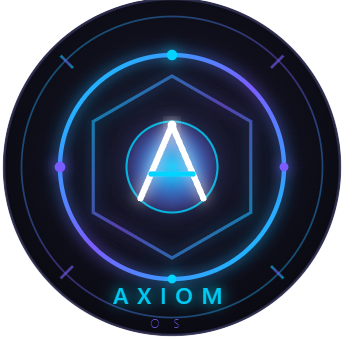

<p align="center">
  <a href="https://axiomos-src.github.io>
    
  </a>
</p>

---

<h1 align="center">AxiomOS</h1>

<p align=center>
  <a href="https://axiomos-src.github.io>
    </a>
  <a href="https://axiomos-src.github.io/downloads">
    </a>
  <a href="https//github.com/axiomos-src/axiomos">
    </a>
  <a href="https://github.com/axiomos-src/axiomos/blob/master/LICENSE">
    </a>
</p>

## What is AxiomOS?
AxiomOS is an open-source operating system, Based on AxiomOS Kernel, This project began in July 31, 2025.

Its original intention was to pave a new path for self-developed operating systems.

> [!WARNING]
> AxiomOS It’s still in an early development version, so if you install it on your computer, it might mess up your computer.

## Building of AxiomOS

If you want to compile AxiomOS, make sure you have a computer running Ubuntu/Debian with at least 5GB of storage and 1GB of RAM.

Please install the following compilation tools:
- x86_64-elf GCC
- CMake
- NASM Assembler
- QEMU (Optional, used for running AxiomOS.)
- Python (Used for scripts)

### Building command

```bash
cmake -S . -B build
cmake -S . -B build -DCMAKE_BUILD_TYPE=Release
```

* Compile mode: Release(Can be set to Debug)
* Arch: x86_64

## License

This project is licensed under [MIT License](LICENSE).

## Bootable images
You can use the axiomos-(Version)-(Date).iso you compiled
or go to https://axiomos.github.io/downloads

For example, the compiled version file name for version 1.1.27 on November 14, 2026, should be axiomos-1.1.27-20261114.iso

## More information
For more information, visit: https://axiomos-src.github.io/moreinfo
or the documentation: https://github.com/axiomos-src/axiomos/blob/master/docs/

# Thanks for reading

### Easter egg
This project is maintained by an 8-year-old Chinese elementary school student, so please forgive any poorly written code o_o
